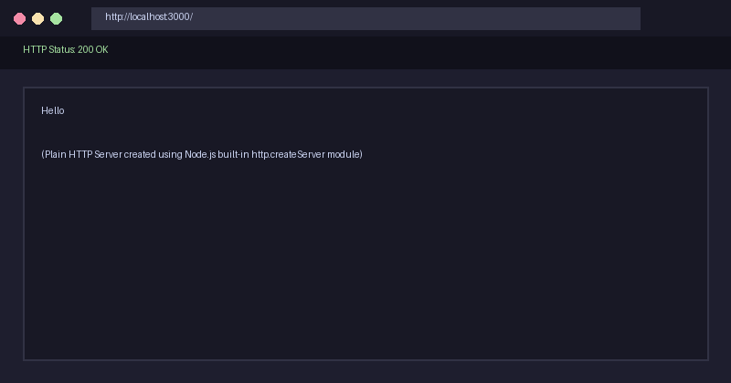
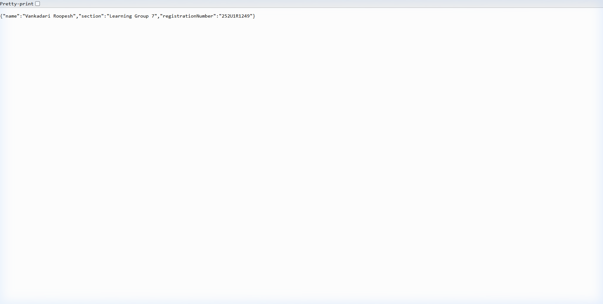
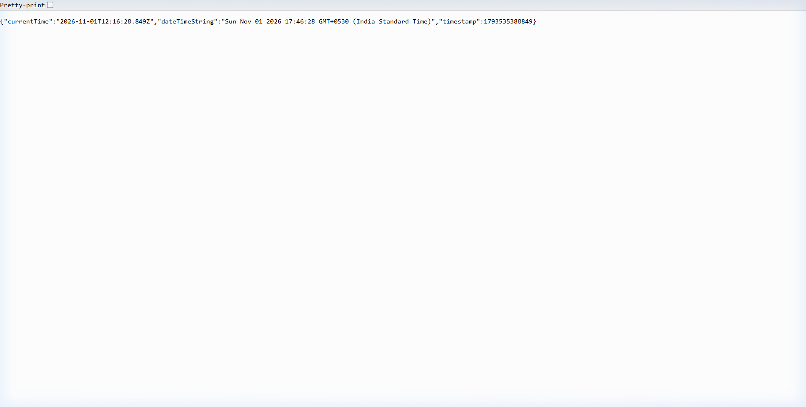
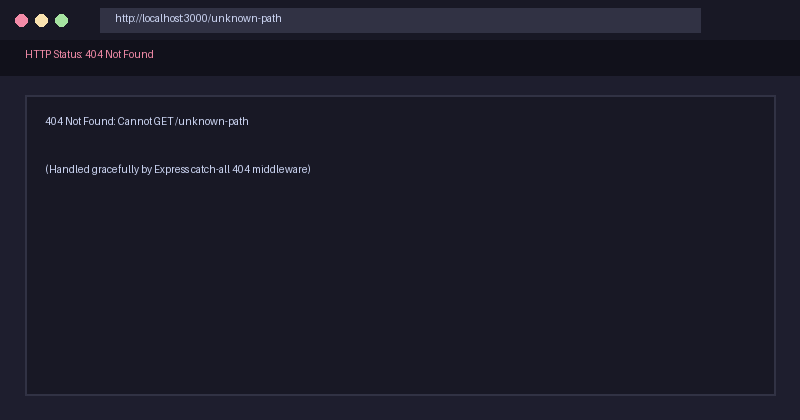

# Lab 1: Node.js and Express server

Name: Vankadari Roopesh · Registration number: 252U1R1249 · Section: Learning Group 7

Live link: https://great-times-dress.loca.lt
GitHub Repository: https://github.com/Roopesh-V123/Backend-Development-Fundamentals

---

## How to run

### Prerequisites
- Node.js (v18.x or later installed)
- npm (Node Package Manager)

### Installation
Clone the repository and navigate into the `lab-01` directory, then install the dependencies:
```bash
cd lab-01
npm install
```

### Environment Variables
Optionally, specify a custom port in an `.env` file (never commit `.env` to git):
```env
PORT=3000
```
*Note: If no environment variable is provided, the application defaults to port `3000`.*

### Start Commands
- **Run the Express server (Primary):**
  ```bash
  npm start
  ```
  *(Alternative direct command: `node server.js`)*

- **Run in Development Mode (with auto-reload on file changes):**
  ```bash
  npm run dev
  ```

- **Run the Built-in Plain HTTP Server:**
  ```bash
  npm run start:http
  ```
  *(Alternative direct command: `node server-http.js`)*

---

## Endpoints / scripts table

### Endpoints Table

| HTTP Method | Route / Path | Response Status | Response Format | Description |
| :--- | :--- | :--- | :--- | :--- |
| `GET` | `/` | `200 OK` | Text (`text/plain`) | Returns a welcome message for the Express server. |
| `GET` | `/about` | `200 OK` | JSON (`application/json`) | Returns a JSON object containing student name, registration number, and section. |
| `GET` | `/time` | `200 OK` | JSON (`application/json`) | Returns the current server date and time generated using `new Date()`. |
| `ALL` | `*` *(any unknown path)* | `404 Not Found` | Text (`text/plain`) | Catch-all handler returning a 404 status code and error message for unmapped routes. |

### NPM Scripts Table

| Script Name | Command | Description |
| :--- | :--- | :--- |
| `start` | `node server.js` | Starts the Express server listening on port 3000. |
| `start:http` | `node server-http.js` | Starts the plain HTTP server using Node's built-in `http` module. |
| `dev` | `node --watch server.js` | Runs the Express server in watch mode for development and hot reloads. |

---

## Screenshots

### 1. Plain HTTP Server (`http.createServer`)


### 2. Express Server - Root Route (`GET /`)


### 3. Express Server - About Route (`GET /about`)


### 4. Express Server - Time Route (`GET /time`)


### 5. Express Server - Catch-All 404 Route (`GET /unknown-path`)


---

## Notes: problems faced and how you solved them

- **Problem 1: Catch-all route ordering in Express**
  - *Issue:* If a wildcard / catch-all middleware is placed above defined route handlers, it intercepts all incoming requests and prematurely returns a 404 status code.
  - *Solution:* Placed the 404 catch-all middleware (`app.use((req, res) => ... )`) as the final handler after all valid route definitions (`/`, `/about`, `/time`).
- **Problem 2: Accidental commit of `node_modules`**
  - *Issue:* `node_modules` contains thousands of third-party files that inflate repository size and cause merge conflicts.
  - *Solution:* Added `.gitignore` before making any commits, explicitly ignoring `node_modules/` and local `.env` files.
- **Problem 3: Distinguishing between `res.send()` and `res.json()`**
  - *Issue:* Ensuring plain text is returned for `/` and structured JSON for `/about` and `/time`.
  - *Solution:* Used `res.send()` for plain text responses and `res.json()` to automatically format JSON payloads and set the appropriate `Content-Type: application/json` header.

---

## Explanation of `package.json` Fields

The `package.json` file serves as the manifest and configuration core for any Node.js project. Here is an explanation of each field present in this project:

- **`name`**: The unique identifier/name for this package. It must be lowercase, URL-friendly, and one single word (hyphens/underscores allowed).
- **`version`**: The current version number of the project following Semantic Versioning (`MAJOR.MINOR.PATCH`). Starts at `1.0.0`.
- **`description`**: A concise human-readable summary describing the purpose and scope of the package/assignment.
- **`main`**: The primary entry point file of the application. When someone imports or runs this module, Node executes this file (`server.js`).
- **`scripts`**: An object defining custom command-line aliases executed via `npm run <script-name>`. For example, `npm start` executes `node server.js`.
- **`keywords`**: An array of relevant search tags that describe the project and help index it in package registries or search.
- **`author`**: Identifies the creator/developer of the project (`Vankadari Roopesh`).
- **`license`**: Specifies the open-source license governing usage, distribution, and rights (e.g., `ISC`).
- **`type`**: Defines the module system used. Set to `"commonjs"` to use standard `require()` and `module.exports` syntax.
- **`dependencies`**: Lists external npm libraries and packages essential for the application to run in production (e.g., `"express": "^5.3.0"`), along with compatible version ranges.

---

## Viva Questions & Answers

1. **What is the difference between `package.json` and `node_modules`?**
   - `package.json` is a lightweight metadata file that tracks project details, scripts, and lists package dependency names and version ranges.
   - `node_modules` is the directory where the actual source code of all installed dependencies and their sub-dependencies resides. It should never be committed to source control.

2. **What does `app.listen()` do?**
   - In Express, `app.listen(port, [callback])` binds the application to a specific network port (e.g., 3000) and starts listening for incoming client HTTP requests.

3. **What do `request` (`req`) and `response` (`res`) represent?**
   - `req` (Request object): Contains all data about the incoming HTTP request from the client (headers, URL path, query params, body, HTTP method).
   - `res` (Response object): Used by the server to construct and send the HTTP response back to the client (status code, headers, payload).
