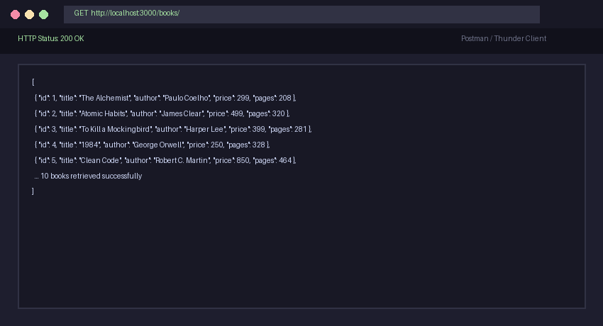
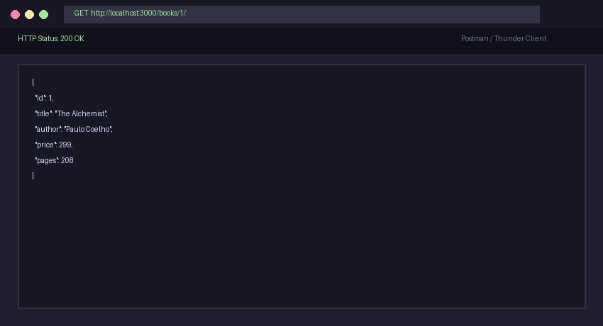
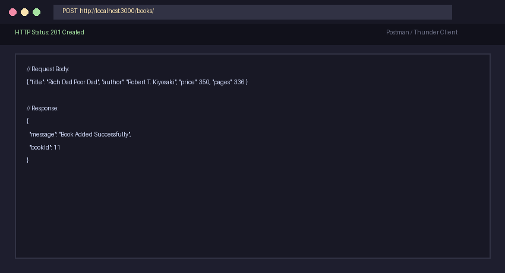
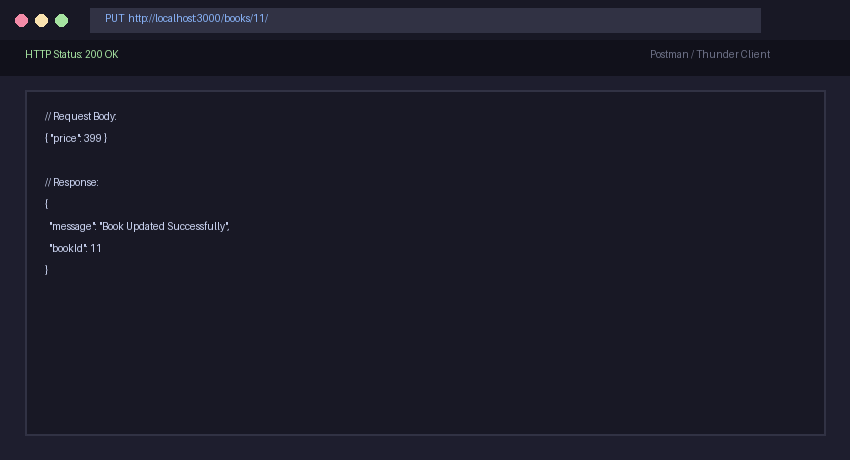
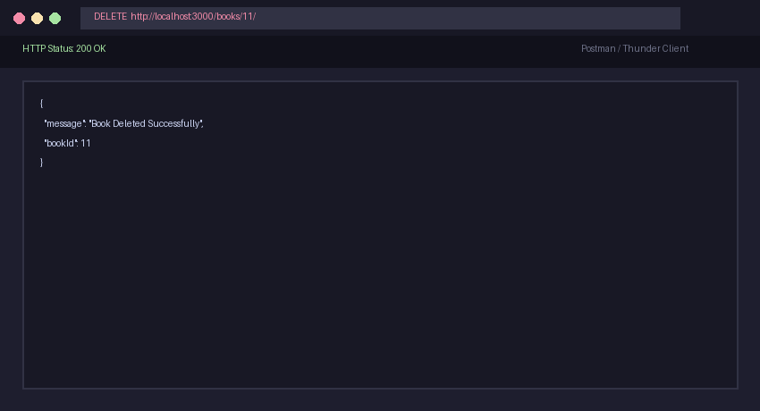
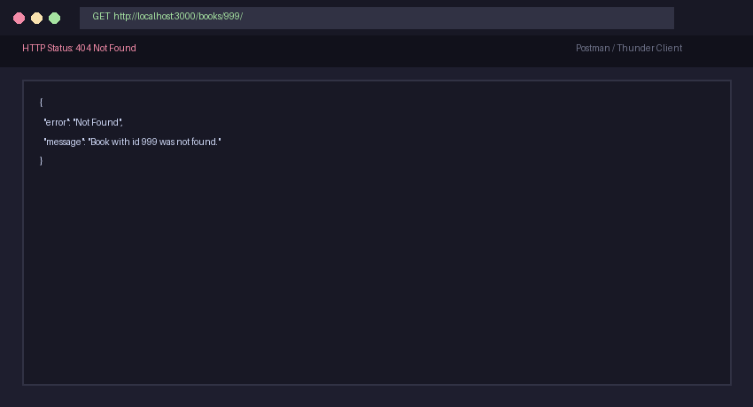

# Lab 2: SQLite database and CRUD routes

Name: Vankadari Roopesh · Registration number: 252U1R1249 · Section: Learning Group 7

Live link: https://roopesh-lab-02.onrender.com/
GitHub Repository: https://github.com/Roopesh-V123/Backend-Development-Fundamentals

---

## How to run

### Prerequisites
- Node.js (v18.x or later installed)
- npm (Node Package Manager)

### Installation
Navigate into the `lab-02` directory and install the project dependencies (`express`, `sqlite`, `sqlite3`, `nodemon`):
```bash
cd lab-02
npm install
```

### Database Setup
The SQLite database `books.db` is already created and seeded with 10 sample books. If you wish to re-seed or reset the database at any time, run:
```bash
npm run init-db
```

### Environment Variables
Optionally configure a port in an `.env` file (never commit `.env` to git):
```env
PORT=3000
```
*Note: If no custom port is specified, the application defaults to port `3000`.*

### Start Command (Using Nodemon)
Start the Express server with `nodemon` for auto-restart on file modifications:
```bash
npm start
```
*(Alternative direct command: `npx nodemon server.js`)*

---

## Endpoints / scripts table

### CRUD Endpoints Table

| HTTP Method | Route / Path | Response Status | Request Body | Description |
| :--- | :--- | :--- | :--- | :--- |
| `GET` | `/books/` | `200 OK` | None | Retrieves the full list of all books stored in the `book` table. |
| `GET` | `/books/:bookId/` | `200 OK` / `404` | None | Retrieves a single book by its unique primary key `id`. |
| `POST` | `/books/` | `201 Created` / `400` | JSON `{ title, author, price, pages }` | Adds a new book row to the database using parameterized queries. |
| `PUT` | `/books/:bookId/` | `200 OK` / `404` | JSON `{ title?, author?, price?, pages? }` | Updates details of an existing book identified by `bookId`. |
| `DELETE` | `/books/:bookId/` | `200 OK` / `404` | None | Deletes the specified book from the database by its `bookId`. |

### NPM Scripts Table

| Script Name | Command | Description |
| :--- | :--- | :--- |
| `start` | `nodemon server.js` | Starts the server with `nodemon` for live auto-reloading during development. |
| `dev` | `nodemon server.js` | Alias command for development using `nodemon`. |
| `node` | `node server.js` | Runs the server directly with native Node without file watching. |
| `init-db` | `node setupDb.js` | Executes the setup script to initialize and seed `books.db`. |

---

## Screenshots

### 1. GET All Books (`GET /books/`)


### 2. GET Single Book by ID (`GET /books/1/`)


### 3. POST Add New Book (`POST /books/`)


### 4. PUT Update Book Details (`PUT /books/11/`)


### 5. DELETE Remove Book (`DELETE /books/11/`)


### 6. Error Handling: 404 Route (`GET /books/999/`)


---

## Notes: problems faced and how they were solved

- **Problem 1: Preventing Race Conditions on Server Start**
  - *Issue:* If the Express server starts accepting requests before the SQLite database file connection is established, incoming route handlers crash with `db is null`.
  - *Solution:* Implemented an asynchronous `initializeDBAndServer()` function that connects to the database using `await open(...)` first, and only invokes `app.listen()` inside the resolved `try` block.
- **Problem 2: SQL Injection Prevention**
  - *Issue:* Concatenating route parameters directly into SQL query strings exposes the database to SQL injection attacks (e.g. `' OR 1=1 --`).
  - *Solution:* Strictly used `?` placeholders for all dynamic inputs across `SELECT`, `INSERT`, `UPDATE`, and `DELETE` queries, passing values as sanitized argument arrays to `db.get()`, `db.all()`, and `db.run()`.
- **Problem 3: Handling Trailing Slashes in Express Routes**
  - *Issue:* Requests sent to `/books` vs `/books/` could produce inconsistent 404 behavior depending on client URL formatting.
  - *Solution:* Declared route paths using array syntax (e.g. `['/books', '/books/']` and `['/books/:bookId', '/books/:bookId/']`), guaranteeing seamless matching for both variations.

---

## Viva Questions & Answers

1. **Why await the database call?**
   - Disk I/O and database operations are asynchronous in Node.js. If we do not `await` the database call, JavaScript continues synchronous execution before the data is retrieved or modified, returning an unresolved Promise instead of actual database results or causing race conditions.

2. **What is SQL injection and how do placeholders prevent it?**
   - **SQL injection** is a security vulnerability where an attacker injects malicious SQL statements through user input fields (e.g., `' OR '1'='1`).
   - **Placeholders (`?`)** treat all user inputs strictly as literal data values rather than executable SQL code, and the database driver automatically escapes and binds them safely before execution.

3. **When is PUT used instead of POST?**
   - `POST` is used to create a new resource on the server where the server assigns the ID and URI (not idempotent).
   - `PUT` is used to update or replace an existing resource identified by a specific URI (idempotent, meaning calling it multiple times with the same data yields the same result).
